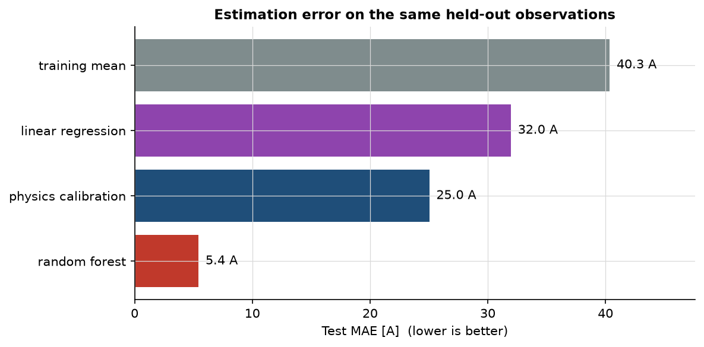
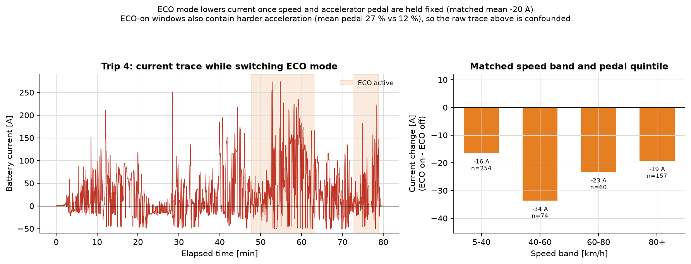

# EV battery current from driving data

This project estimates an electric car's **signed battery current** from signals
recorded at the same moment: speed, acceleration, pedal position, road grade and
the ECO / air-conditioning states. Positive current means the battery is being
drained. Negative current means energy is flowing back through regenerative
braking.

The aim is a model that works on new drivers and a new day, not one that
memorises the route.

Built for *Python for Engineers* at Türk-Alman Üniversitesi (Winter 2026).

[Live case study](https://cankecilioglu.dev/work/ev-telemetry) ·
[Dataset](https://www.kaggle.com/datasets/marceloreis76/electric-vehicle-telemetry-dataset)

## Quick start

```bash
python -m venv .venv
.venv\Scripts\activate            # Linux/macOS: source .venv/bin/activate
pip install -r requirements.txt

# put dataset.csv from Kaggle into data/raw/
python main.py --data data/raw/dataset.csv
pytest -q
```

Every figure and table is written to `results/`. The pipeline does not open a
window, so it also runs on a machine without a display.

To read the full story with outputs, open `exploration.ipynb` on GitHub. To run
it yourself:

```bash
pip install -r requirements-notebook.txt
jupyter lab exploration.ipynb
```

## The data

Nine trips by nine drivers over the same ~76 km route in Brazil, October 2023.
The file has 24,277 rows and roughly 2 s sampling.

The raw CSV is **not included** here: it is a GPL-3.0 dataset and keeping it out
keeps the repository small. Download `dataset.csv` from the Kaggle link above and
place it in `data/raw/`.

If you use the data, cite the original paper:

> dos-Reis, M., Frison, C. I., Teixeira, F. C., & Marques-Neto, H. T. (2024).
> Using Electric Vehicle Driver's Driving Mode for Trip Planning and Routing.
> *Journal of Internet Services and Applications, 15*(1), 410–423.
> https://doi.org/10.5753/jisa.2024.3805

## What the pipeline does

1. **Cleans the data.**
2. **Explores how the car is driven.**
3. **Fits a simple physics model.**
4. **Trains a Random Forest.**
5. **Compares both with a mean baseline.**
6. **Checks where the errors come from.**

### 1. Clean the data

The file looks tidy but is not:

| Problem | What happens |
| --- | --- |
| Rows from all trips are mixed together | Sort by trip and time first |
| 97 timestamps are impossible or contradict the recording order | Drop those rows; they cannot be placed in time |
| Pack voltage is broken on 7 of 9 trips (0–25 V instead of ~350 V) | Keep the rows, mark them with `vol_valid` |
| 4 altitude values are 0 and 21 GPS fixes fall outside Brazil | Flag them; do not delete the rows |
| The accelerometer `AX` has a per-trip offset | Use `dSPD/dt` instead; `AX` is not a reliable acceleration signal |

After cleaning: **24,180 rows**, 0.40 % removed. The full report is in
[`results/tables/data_quality_report.md`](results/tables/data_quality_report.md).

### 2. Fit a physics model

The car's power balance at the battery is:

```text
I = [ m·a·v + ½·ρ·C_d·A·v³ + m·g·sin(θ)·v + C_rr·m·g·v ] / (η·V_nom)
    + (P_base + P_air·AIR) / V_nom
```

- `v` is speed and `a` is acceleration from `dSPD/dt`.
- `θ` is road grade, estimated from altitude and distance over the last ~30 s.
- `m`, `C_d`, `A`, `C_rr` and `ρ` describe the car and the air.
- `η` is drivetrain efficiency, assumed 0.90.
- `V_nom` is 350 V, because the measured voltage is unreliable.
- `P_base` and `P_air` are the base and air-conditioning loads.

Dividing by voltage makes the equation **linear in six coefficients**. They are
fitted with ordinary least squares on the training rows only.

The fitted values are then translated back into real quantities: two independent
mass estimates agree within 10 % (873 kg and 959 kg), `C_dA` is 0.917 m² and
`C_rr` is 0.0095. The absolute mass is about 40 % below the published kerb mass;
the likely reasons are the coarse 2 s acceleration estimate and using one
efficiency for both driving and regeneration. That is reported as a limitation,
not hidden.

### 3. Train and test honestly

The rows are sorted by time. The first 80 % is the training set, the last 20 % is
the test set. Nothing is shuffled, and the test set contains drivers and a day
the model has not seen.

The split falls on 26 October 2023:

- Training: 19,344 rows.
- Test: 4,836 rows.

Everything learned — coefficients, missing-value imputer, Random Forest
settings — is fitted on the training set only. The Random Forest is tuned with
time-series cross-validation inside the training set.

A second check holds out the last 20 % of **every trip**, so all nine drivers
appear in the test set. The ranking does not change.

### 4. Compare four models

| Model | Test MAE | RMSE | Bias | R² |
| --- | --- | --- | --- | --- |
| Mean baseline | 40.35 A | 54.58 | −2.84 | −0.003 |
| Linear: speed + acceleration | 31.96 A | 43.94 | −2.62 | 0.350 |
| Physics model | 25.03 A | 36.05 | −0.47 | 0.562 |
| Random Forest | **5.43 A** | 9.43 | −0.47 | 0.970 |



The Random Forest is much better, but there is a catch. The accelerator pedal
alone correlates with current at r = +0.91, and 90 % of the forest's importance
lands on the pedal. In practice it has learned this car's pedal-to-current map.
That is a valid signal, but it will not transfer to another EV as well as the
physics model would.

The physics model is the one that generalises. The forest is the one that wins on
this dataset.

### 5. Where the errors are

- The **mean baseline** cannot follow demand: it is about 36 A too low above
  80 km/h and 29 A too low uphill.
- The **physics model** is best while braking (14.6 A) and worst at high speed
  (up to 45 A), where aerodynamic assumptions matter most.
- The **Random Forest** stays between 2.6 and 7.4 A in every speed band. Its
  largest remaining bias is about −3.5 A at 80–100 km/h.

### 6. The ECO-mode trap

Trip 4 switches ECO mode on and off four times, so it looks like a clean test.
It is not. ECO-on windows also have about twice the accelerator pedal (27 % vs
12 %) and sit on slightly uphill road (+2.2 % vs −1.2 % grade). Raw current is
therefore *higher* with ECO on: 49.5 A vs 19.7 A.

Compare only samples in the same speed band **and** the same pedal range, and the
answer flips: ECO-on current is 16–34 A lower, about −20 A on average. The mode
does save energy; the raw comparison was really measuring the driver's right
foot.



## What I took away

- Real data is rarely clean. The cleaning decisions are part of the result.
- A simple physics model is easier to explain and travels better than a model
  that only fits one car.
- A raw before/after comparison can point the wrong way. Matching speed and pedal
  turned a +30 A "increase" into a −20 A saving.

## Project layout

```text
main.py                 command-line entry point
exploration.ipynb       full analysis with saved outputs
src/                    cleaning, features, models, plots, reports
tests/                  28 tests
results/figures/        fig01 … fig07
results/tables/         data quality and model results
data/raw/               dataset.csv (not committed)
```

## Reproducibility

- Random seed is fixed (`RANDOM_SEED = 42`).
- Paths are resolved from the repository root.
- `python main.py --data <path>` runs everything.
- Add `--stage clean`, `--stage explore` or `--stage baseline` to run one part.
- Add `--no-tune` to skip the grid search for a quick run.
- `pytest -q` runs 28 tests; all pass.
- The full pipeline takes about a minute on a laptop.

## Licence

- **Code:** MIT, © 2026 Can Keçilioğlu.
- **Dataset:** GPL-3.0, © the original authors. The raw CSV is not redistributed.
